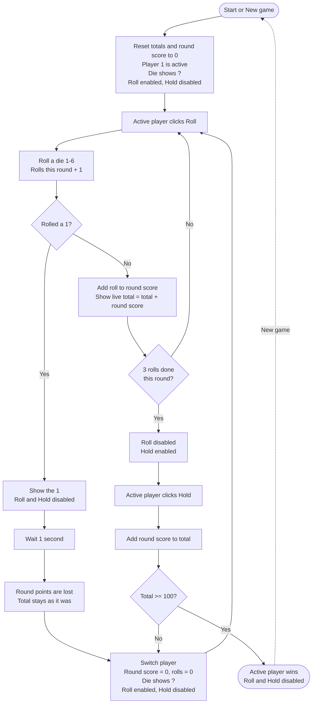

# Pig Game Flowchart

## Rules the chart shows

- Each round a player must roll the die **three times** before **Hold** unlocks.
- Rolling a **1** ends the round early: the round's points are lost and the turn passes after a one second pause.
- **Hold** adds the round score to the player's total and passes the turn.
- The first player whose total reaches **100** wins.
- **New game** can be pressed at any time and returns to the start.
